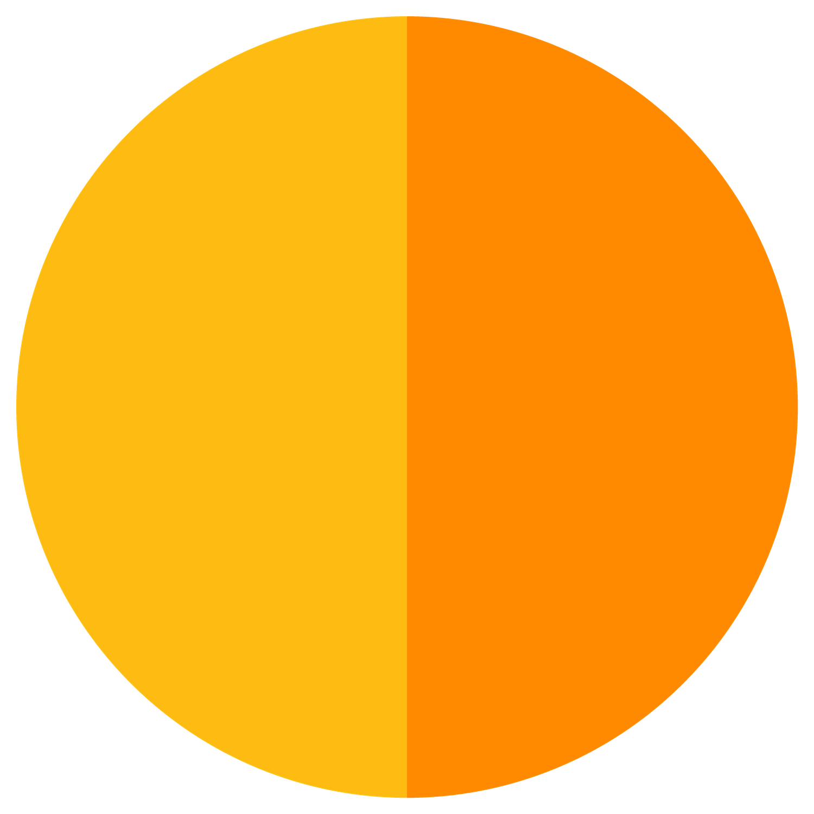

<!-- pr:begin header -->


# SlidesConnect
> Grasshopper plugin for the Google Slides REST API — by Eesha Jain
>
> Built with the [PleaseREST](https://github.com/eesha-on-jupiter/PleaseREST) Claude Code plugin — an AI pipeline that turns a REST API reference into a Grasshopper plugin.

Author, populate and restyle Google Slides decks from a Grasshopper canvas: build slides, shapes, text, tables and images as request JSON from lists and data trees, gather them with one aggregator, and push the whole deck to a live presentation in a single `batchUpdate` call.

<br clear="left">

## What you can do with it

Turn model data into presentation slides, and regenerate them whenever the design changes:

- **One slide per record** — a list, a data tree or a CSV (one row per floor, option or zone) becomes one slide each, filled into a hand-designed Layout's title, body and picture placeholders.
- **Rhino views on slides** — move the camera to a list of planes, capture a PNG at each, host it on Drive and place it, one view per slide.
- **Diagrams from geometry** — Rhino rectangles become positioned, rotated Slides shapes, coloured by value through a Grasshopper `Gradient`, across all 141 Slides shape types.
- **Schedules and results tables** — a data tree becomes a Slides table; cell fill, borders, merges and column widths are set from the graph.
- **Styled text without index bookkeeping** — text boxes with any mix of font, size, colour, bullets and alignment, down to per-letter styling, with no character indices to compute.

Component chains for each of these are in [docs/workflows.md](docs/workflows.md).

**Under the hood**

- Lists in, requests out — every builder input is a list matched by index (one value broadcasts), and new slides and shapes hand their IDs straight to the next component.
- One `batchUpdate` per click — Requests Aggregator flattens every list or tree into one ordered payload; Batch Update only sends when its **Send** button is clicked.
<!-- pr:end header -->

<!-- pr:begin install -->
## Installation

**Food4Rhino:** (pending first release)
**Yak:** `_PackageManager` → search `slidesconnect` (pending first release)

**Rhino 8 note:** the Rhino 8 packages are built for .NET 7 and load only when Rhino runs on the .NET Core runtime (its default). If the SlidesConnect tab is missing, run `SetDotNetRuntime` in Rhino, choose **.NET Core**, and restart — Rhino.Inside Revit setups often switch this to .NET Framework.

**From source:** `dotnet build SlidesConnect.csproj`, then drop the `.gha` for your Rhino version into Grasshopper's `Libraries` folder (Rhino 7: `bin/Debug/net48`; Rhino 8 Windows: `bin/Debug/net7.0-windows`; Rhino 8 Mac: `bin/Debug/net7.0`) and restart Rhino — or point Grasshopper's developer-folder setting at the build folder. Close Rhino before rebuilding; it locks the `.gha`.
<!-- pr:end install -->

<!-- pr:begin quickstart -->
## Quick start

1. Get an OAuth 2.0 access token from the [Google OAuth Playground](https://developers.google.com/oauthplayground/) with the `https://www.googleapis.com/auth/presentations` scope (add `drive.file` to host local images, `drive.readonly` to look presentations up by name). See [docs/authentication.md](docs/authentication.md).
2. Drop **Google Slides Auth** (Auth tab) and plug the token into `Token` — `Status` reports the granted scopes.
3. **Create Presentation** (Presentation tab) with a title, click **Create** → `Presentation ID`.
4. Author content: **Create Slide** → `Slide ID` → **Create Shape** / **Styled Text Box** / **Create Image** / **Data Tree To Table**… each emits `Request JSON`.
5. Wire every `Request JSON` into **Requests Aggregator** (Aggregate tab), slide first, through a Merge or one wire each.
6. **Batch Update** with the token, the Presentation ID and the aggregator's `Requests JSON` — click **Send**.

Full walkthrough: [docs/quickstart.md](docs/quickstart.md). Common wirings as component chains: [docs/workflows.md](docs/workflows.md). Reference for every component: [docs/index.md](docs/index.md).
<!-- pr:end quickstart -->

<!-- pr:begin components -->
## Components

| Tab | Component | Inputs | Outputs | Description |
|---|---|---|---|---|
| Auth | Google Slides Auth | Token | Status, Response | Validate a Google OAuth access token and confirm it can reach the Slides API. |
| Presentation | Batch Update | Token, Presentation ID, Requests JSON | Replies, Status, Response | Apply a list of request JSON to a presentation in a single batchUpdate call. |
| Presentation | Create Presentation | Token, Title | Presentation ID, Status, Response | Create a new blank Google Slides presentation with the given title. |
| Presentation | Get Presentation | Token, Presentation ID, Name | Response, Presentation ID, Status | Retrieve the full JSON of a presentation by ID, or by title. |
| Slides | Create Slide | Layout, Insertion Index, Object ID, Layout ID, Title Placeholder ID, Body Placeholder ID, Picture Placeholder ID | Request JSON, Slide ID, Title Object ID, Body Object ID, Picture Object ID | Build requests that add one or more new slides, optionally populating layout placeholders. |
| Slides | Delete Slide | Slide ID | Request JSON | Build requests that delete one or more slides or page elements by object ID. |
| Slides | Get Slide | Token, Presentation ID, Slide ID | Response, Status | Retrieve a single slide by its object ID. |
| Slides | Update Slide Background | Slide ID, Color | Request JSON | Build requests that set one or more slides' background color. |
| Layouts | Build Slides From Layout | Token, Presentation ID, Layout ID, Title, Subtitle, Body, Photo URL | Request JSON, Slide ID | Build a full deck's requests from a Layout and Title/Subtitle/Body/Photo URL lists — one slide per record. |
| Layouts | Get CSV Column | Columns, Headers, Header Name | Values, Found | Pull one column out of Read CSV's output by header name. |
| Layouts | List Layout Placeholders | Token, Presentation ID, Layout ID | Placeholder ID, Placeholder Type | List the placeholder page elements on a Layout page (object ID + placeholder type). |
| Layouts | List Layouts | Token, Presentation ID | Layout ID, Layout Name | List the Layout pages available in a presentation (object ID + display name). |
| Layouts | Read CSV | File Path, Has Headers, Delimiter, Encoding | Columns, Headers, Rows, Cols, Error | Reads a CSV file and outputs a column-per-branch tree. Wire a column straight into Build Slides From Layout / Build Simple Slide. |
| Shapes | Create Shape | Slide ID, Shape Type, Width, Height, X, Y, Unit, Object ID, Color, Outline Weight, Rotation, Flip X, Flip Y, Skew X, Skew Y | Request JSON, Object ID | Build requests that add one or more shapes at a given size and position, optionally styled. |
| Shapes | Rhino Shape Export | Rectangle, Unit, Fit To Page | X, Y, Width, Height, Rotation, Unit | Convert one or more Rhino rectangles into Slides position, size and rotation (in the model unit, Y flipped to Slides' top-left origin). |
| Shapes | Shape Fill | Object ID, Fill Color, Fill Transparency | Request JSON | Sets the fill colour and/or transparency of one or more existing shapes. Only the inputs you connect are applied. |
| Shapes | Shape Link | Object ID, URL | Request JSON | Hyperlinks one or more existing shapes to a URL — the whole shape becomes clickable. For linking only the text, use Link Text. |
| Shapes | Shape Outline | Object ID, Outline Color, Outline Weight, Outline Dash, Unit | Request JSON | Sets the outline colour, weight and/or dash style of one or more existing shapes. Only the inputs you connect are applied. |
| Shapes | Shape Shadow | Object ID, Shadow, Shadow Color, Transparency, Blur, Offset X, Offset Y, Unit | Request JSON | Adds a soft outer drop shadow to one or more existing shapes (colour, transparency, blur, offset), or removes it with Shadow = false. |
| Shapes | Shape Text Fit | Object ID, Content Alignment, Autofit | Request JSON | Sets how text sits in one or more existing shapes: vertical alignment (TOP/MIDDLE/BOTTOM) and autofit (NONE/TEXT_AUTOFIT/SHAPE_AUTOFIT). Only the inputs you supply are applied. |
| Shapes | Update Shape Style | Object ID, Fill Color, Fill Transparency, Outline Color, Outline Weight, Outline Dash, Shadow, Content Alignment, Autofit, Link URL, Unit | Request JSON | Restyles one or more shapes with any combination of fill colour/transparency, outline colour/weight/dash, shadow, vertical text alignment, autofit and link. Only the inputs you connect are applied. |
| Shapes | Update Shape Transform | Object ID, X, Y, Scale X, Scale Y, Rotation, Unit, Flip X, Flip Y, Skew X, Skew Y, Width, Height, Relative | Request JSON | Build requests that set one or more elements' position, scale, rotation, flip and skew (absolute, about the centre when Width/Height are given), or move them by a delta (Relative). |
| Text | Insert Text | Object ID, Text | Request JSON | Build requests that insert text into one or more shapes or placeholders. |
| Text | Replace All Text | Find Text, Replace Text, Match Case | Request JSON | Build requests that replace all occurrences of each Find Text with its Replace Text across the presentation — one per record, index-matched. |
| Text | Styled Text Box | Slide ID, Text, X, Y, Width, Height, Unit, Object ID, Bold, Italic, Underline, Strikethrough, Font Size, Font Family, Text Color, Highlight, Link URL, Baseline, Alignment, Line Spacing, Bullet Preset, Fill Color, Content Alignment, Autofit, Rotation, Flip X, Flip Y, Skew X, Skew Y, Same Box, Separator | Request JSON, Object ID | Creates a text box per record, inserts the text, and applies any combination of styles — bold, italic, underline, strikethrough, size, font, color, highlight, link, baseline, alignment, line spacing, bullets, fill, vertical alignment, autofit, rotation, flip, skew. Only the inputs you connect are applied. Newlines in Text make paragraphs. Same Box = true joins every Text item into ONE box, each item keeping its own style (font-size wave, colour gradient across a sentence). |
| Text Style | Aligned Text | Object ID, Alignment | Request JSON | Sets the paragraph alignment of the text in one or more shapes. One updateParagraphStyle request per record. |
| Text Style | Baseline Text | Object ID, Baseline | Request JSON | Raises or lowers the text in one or more shapes (superscript / subscript). One updateTextStyle request per record. |
| Text Style | Bold Text | Object ID, Bold | Request JSON | Makes the text in one or more shapes bold (or un-bold). One updateTextStyle request per record. |
| Text Style | Bullet List | Object ID, Bullet Preset, Row, Column | Request JSON | Turns the paragraphs in one or more shapes or table cells into a bulleted or numbered list (one line = one item). Bullet Preset NONE removes existing bullets. Row/Column target a table cell instead of a shape. |
| Text Style | Font Family Text | Object ID, Font Family | Request JSON | Sets the font family of the text in one or more shapes. One updateTextStyle request per record. |
| Text Style | Font Size Text | Object ID, Font Size | Request JSON | Sets the font size of the text in one or more shapes. One updateTextStyle request per record. |
| Text Style | Highlight Text | Object ID, Highlight | Request JSON | Puts a highlight colour behind the text in one or more shapes. One updateTextStyle request per record. |
| Text Style | Indent Text | Object ID, Indent | Request JSON | Indents the paragraphs in one or more shapes. One updateParagraphStyle request per record. |
| Text Style | Italic Text | Object ID, Italic | Request JSON | Makes the text in one or more shapes italic. One updateTextStyle request per record. |
| Text Style | Line Spacing Text | Object ID, Line Spacing | Request JSON | Sets the line spacing of the paragraphs in one or more shapes. One updateParagraphStyle request per record. |
| Text Style | Link Text | Object ID, URL | Request JSON | Turns the text in one or more shapes into a hyperlink. One updateTextStyle request per record. |
| Text Style | Space Above Text | Object ID, Space Above | Request JSON | Adds space above the paragraphs in one or more shapes. One updateParagraphStyle request per record. |
| Text Style | Space Below Text | Object ID, Space Below | Request JSON | Adds space below the paragraphs in one or more shapes. One updateParagraphStyle request per record. |
| Text Style | Strikethrough Text | Object ID, Strikethrough | Request JSON | Strikes through the text in one or more shapes. One updateTextStyle request per record. |
| Text Style | Styled Paragraph | Object ID, Alignment, Line Spacing, Indent, Space Above, Space Below, Indent End, First Line Indent, Direction, Row, Column | Request JSON | Styles the paragraphs in one or more shapes or table cells with any combination of paragraph-level traits — alignment, line spacing, indent, space above/below, direction. Only supplied properties are applied. Row/Column target a table cell instead of a shape. |
| Text Style | Styled Text | Object ID, Bold, Italic, Underline, Strikethrough, Font Size, Font Family, Text Color, Highlight, Link URL, Baseline, Small Caps, Row, Column | Request JSON | Styles the text in one or more shapes or table cells with any combination of traits — bold, italic, underline, strikethrough, size, font, color, highlight, link, baseline, small caps. Only the inputs you connect are applied. Row/Column target a table cell instead of a shape. |
| Text Style | Text Color Text | Object ID, Text Color | Request JSON | Sets the colour of the text in one or more shapes. One updateTextStyle request per record. |
| Text Style | Underline Text | Object ID, Underline | Request JSON | Underlines the text in one or more shapes. One updateTextStyle request per record. |
| Tables | Create Table | Slide ID, Rows, Columns, Object ID | Request JSON, Object ID | Build requests that add one or more empty tables of given rows and columns to a page. |
| Tables | Data Tree To Table | Slide ID, Data | Request JSON | Build createTable + per-cell insertText requests from a data tree (one branch per row). |
| Tables | Merge Cells | Object ID, Row, Column, Row Span, Column Span, Unmerge | Request JSON | Merges a rectangular range of cells in an existing table (e.g. a header spanning every column), or unmerges it with Unmerge = true. Merging keeps only the top-left cell's text. |
| Tables | Table Borders | Object ID, Row, Column, Row Span, Column Span, Border Position, Border Color, Border Weight, Border Dash, Unit | Request JSON | Sets border colour, weight and/or dash on one side (or ALL / OUTER / INNER) of a range of cells in an existing table. Row/Column -1 = whole table. Only the inputs you connect are applied. |
| Tables | Table Cell Style | Object ID, Row, Column, Row Span, Column Span, Fill Color, Content Alignment | Request JSON | Sets the fill colour and/or vertical content alignment of a range of cells in an existing table (Row/Column -1 = whole table). For the cell text itself use Styled Text / Styled Paragraph with Row/Column. |
| Tables | Table Column Width | Object ID, Column Index, Width, Unit | Request JSON | Sets the width of columns of an existing table — one record per column (Column Index + Width, index-matched); a single Width broadcasts across every listed column. |
| Insert | Capture Camera View | Camera Plane, Projection, View Name, File Path, Width, Height, Restore View | File Path | Move the Rhino camera to one or more Planes and capture a PNG at each — e.g. one per floor. |
| Insert | Create Image | Slide ID, Image URL, Width, Height, X, Y, Unit, Object ID, Rotation, Flip X, Flip Y, Skew X, Skew Y | Request JSON, Object ID | Build requests that embed one or more images by URL at a given size and position. |
| Insert | Get Image URL | Token, Bitmap, File Path, URL | Image URL | Resolves images to public URLs for Create Image / Build Slides From Layout. URLs pass through; Bitmaps and local File Paths are uploaded to Google Drive and made link-public (needs drive.file scope). |
| Insert | Replace Image | Object ID, Image URL | Request JSON | Build requests that swap the image content of one or more existing image elements (e.g. a filled Picture placeholder). |
| Aggregate | Requests Aggregator | Request JSON | Requests JSON | Collect many Request JSON items into one Requests JSON list for BatchUpdate. |
| Presets | Alignment | — | Value list | Paragraph alignment values for Styled Paragraph / Aligned Text / Styled Text Box. |
| Presets | Border Position | — | Value list | Which borders of a table range Table Borders styles. |
| Presets | Bullet Preset | — | Value list | Bullet / numbering preset values for Bullet List / Styled Text Box (Google Slides BulletGlyphPreset names). |
| Presets | Content Alignment | — | Value list | Vertical text alignment values for Shape Text Fit / Table Cell Style / Styled Text Box. |
| Presets | Dash Style | — | Value list | Line dash values for Shape Outline / Table Borders. |
| Presets | Font Family | — | Value list | Curated shortcut list of common font families for Styled Text / Font Family Text — not a closed list, any Google Fonts name can be typed directly. |
| Presets | Predefined Layout | — | Value list | Predefined Google Slides slide layouts. |
| Presets | Shape Type | — | Value list | Every Google Slides shape type (141) for Create Shape — basic, arrows, stars, callouts, ribbons, braces, math, flow chart. |
<!-- pr:end components -->

<!-- pr:begin requirements -->
## Requirements

- Rhino 7 or 8 (Windows or Mac)
- A Google account; a Google Cloud OAuth client if you need tokens that outlive the Playground's one hour
- OAuth scopes: `https://www.googleapis.com/auth/presentations` (all Slides calls); `https://www.googleapis.com/auth/drive.file` (Get Image URL uploads); `https://www.googleapis.com/auth/drive.readonly` (Get Presentation's lookup by name)

## Documentation

- [docs/index.md](docs/index.md) — overview and every component by tab
- [docs/quickstart.md](docs/quickstart.md) — first slide in five steps
- [docs/workflows.md](docs/workflows.md) — common wirings as component chains
- [docs/authentication.md](docs/authentication.md) — tokens and scopes
- [docs/changelog.md](docs/changelog.md)

## Development

```
dotnet build SlidesConnect.csproj                            # net48, net7.0-windows, net7.0
dotnet test  SlidesConnect.Tests/SlidesConnect.Tests.csproj   # builder logic, no Rhino needed
```

This plugin was generated with the **PleaseREST** Claude Code plugin (`please-rest` v1.0.0); `CLAUDE.md` holds the build state and design notes.
<!-- pr:end requirements -->

<!-- pr:begin license -->
## License

SlidesConnect is released under the MIT License — Copyright (c) 2026 Eesha Jain. See [LICENSE](LICENSE).
<!-- pr:end license -->
