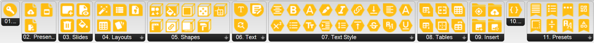

# SlidesConnect

SlidesConnect is a Grasshopper plugin for Rhino 7/8 (Windows and Mac) that wraps the
[Google Slides API](https://developers.google.com/slides/api/reference/rest) to build and edit presentations. It lets you author,
populate, and restyle Google Slides presentations entirely from a Grasshopper canvas — build a
request in JSON-emitting components, gather those requests, then push them to a live presentation in
one `batchUpdate` call. Multi-slide decks are driven parametrically: feed a Grasshopper list (or a
data tree from a CSV) and get one slide per record, each targeted independently within the same
batch.

- **Platform:** [Google Slides API](https://developers.google.com/slides/api/reference/rest) v1
- **Auth:** Google OAuth access token required, see [Authentication](authentication.md)
- **Version:** 1.0.0
- **Rhino support:** Rhino 7 (.NET Framework 4.8), Rhino 8 Windows (.NET 7), Rhino 8 Mac (.NET 7)
- **License:** MIT
- **GitHub:** https://github.com/eesha-on-jupiter/SlidesConnect
- **Food4Rhino:** _(added once listed on food4rhino.com)_
- **Released:** _(added at first tagged release)_
- **Made with:** [PleaseREST](https://github.com/eesha-on-jupiter/PleaseREST)

## Features

- **Parametric multi-slide generation** — list-access is the default across almost every component:
  feed N items into a unit builder (Create Slide, Create Shape, Insert Text, …) and get back N
  requests, index-matched to the input. One CSV of floor data or one data tree drives an entire deck
  in a single push, with no per-slide manual wiring.
- **Two ways to build a deck** — [Build Slides From Layout](components/Layouts/BuildSlidesFromLayout.md)
  fills a hand-designed Layout's real placeholders (title/body/picture) from flat Title/Body/Photo
  URL lists, one slide per record; without a Layout, [Create Slide](components/Slides/CreateSlide.md)
  (BLANK) + [Styled Text Box](components/Text/StyledTextBox.md) place each record's text exactly
  where you say. The lower-level [Create Slide](components/Slides/CreateSlide.md) +
  [List Layout Placeholders](components/Layouts/ListLayoutPlaceholders.md) +
  [Insert Text](components/Text/InsertText.md) + [Replace Image](components/Insert/ReplaceImage.md)
  chain still exists underneath both for anyone who needs finer per-element control.
- **Auto-threaded IDs** — every creation component (Create Slide, Create Shape, Create Table, Create
  Image) auto-generates its own Slide ID/Object ID when left blank and resolves it back out on a
  companion output, so the same ID can be threaded forward to target something created earlier in
  the same batch (e.g. a new slide's Slide ID feeding straight into a shape's Slide ID).
- **Rhino geometry → Slides shapes** — [Rhino Shape Export](components/Shapes/RhinoShapeExport.md)
  converts Rhino geometry directly into Slides coordinates (position, size, rotation) so
  [Create Shape](components/Shapes/CreateShape.md) can place a styled shape at the same location on
  the slide.
- **Image pipeline** — move the Rhino camera to one or more planes and capture a PNG at each
  ([Capture Camera View](components/Insert/CaptureCameraView.md)), host them via
  [Get Image URL](components/Insert/GetImageUrl.md) (Drive upload, no external server needed), then
  place or replace it inline on a slide.
- **CSV-driven decks** — [Read CSV](components/Layouts/ReadCsv.md) plus
  [Get CSV Column](components/Layouts/GetCsvColumn.md) pull per-record data (e.g. one row per
  building floor) straight into the same list-access builders, no hardcoded "record" concept
  anywhere in the plugin.
- **Data-driven tables** — build a table directly ([Create Table](components/Tables/CreateTable.md))
  or straight from a Grasshopper data tree ([Data Tree To Table](components/Tables/DataTreeToTable.md)).
- **Text and paragraph styling** — insert and find/replace text ([Text tab](components/Text/index.md)),
  then restyle it in any shape, placeholder or table cell ([Text Style tab](components/TextStyle/index.md)).
- **Curated presets** — value-list shortcuts for predefined layouts, shape types, alignment, font
  family, bullets, dash styles, border positions and vertical alignment, so you're not guessing at
  Google's enum strings. See [Presets tab](components/Presets/index.md).
- **Native colours** — every colour input (fills, outlines, shadows, text, highlights, cell fills,
  borders, slide backgrounds) is a Grasshopper Colour parameter: wire a Colour Swatch, a `Gradient`
  output, or a panel containing `255,0,0`. The plugin converts to the API's 0–1 RGB JSON itself.
- **Designs, not just decks** — every element's placement is the full affine transform: rotation,
  flip X/Y, skew X/Y and scale, all list-driven and pivoting about the element's centre, over all 141
  of the API's shape types. A `Range` into Rotation fans a row of shapes; a Rhino curve divided into
  planes → [Rhino Shape Export](components/Shapes/RhinoShapeExport.md) → [Create Shape](components/Shapes/CreateShape.md)
  lays elements along it; alternating Flip X mirrors every other one.
- **Styling parity with DocsConnect** — [Styled Text](components/TextStyle/UpdateTextStyle.md),
  [Styled Paragraph](components/TextStyle/UpdateParagraphStyle.md) and [Bullet List](components/TextStyle/BulletList.md)
  mirror DocsConnect's combined stylers, adapted to Slides' object model: Docs inserts styled text at
  an index, Slides styles the text already in a shape, placeholder or table cell by Object ID.
  [Styled Text Box](components/Text/StyledTextBox.md) is the one-call "make me a styled text box".
  Every trait input is list-access, so one Gradient or one CSV column styles N objects at once.

## Install

Install via the Rhino Package Manager (`_PackageManager` in Rhino) and search for
**slidesconnect**, or unzip the release `.zip` for your platform into Grasshopper's Components
Folder and restart Rhino. On Rhino 8 the plugin needs the .NET Core runtime (the default) — if the
tab is missing, run `SetDotNetRuntime`, choose **.NET Core** and restart. See
[authentication.md](authentication.md) for how to get a token before your first live call.

## Components by tab

| Tab | Type | Components | What it's for |
|---|---|---|---|
| [Auth](components/Auth/index.md) | HTTP | 1 | Validate a Bearer token before doing anything else |
| [Presentation](components/Presentation/index.md) | HTTP | 3 | Create/get a presentation, push a batch of requests |
| [Slides](components/Slides/index.md) | Mixed | 4 | Get a slide's raw JSON, create/update/delete slides |
| [Layouts](components/Layouts/index.md) | Mixed | 5 | Discover a presentation's Layouts and their placeholders, build a full deck from a Layout, read CSV data in |
| [Shapes](components/Shapes/index.md) | Mixed | 9 | Create (with rotation) / restyle / transform shapes, convert Rhino geometry to Slides coordinates |
| [Text](components/Text/index.md) | JSON | 3 | Insert text, find/replace, or build a styled text box — including per-letter / per-word styling |
| [Text Style](components/TextStyle/index.md) | JSON | 18 | Style text already in a shape or cell — Styled Text / Styled Paragraph / Bullet List plus one-trait components (Bold Text, Font Size Text, …) |
| [Tables](components/Tables/index.md) | JSON | 6 | Build a table directly or from a data tree; cell fill, borders, merge, column widths |
| [Insert](components/Insert/index.md) | JSON | 4 | Place/replace images, host local images on Drive, capture N camera views from N planes |
| [Aggregate](components/Aggregate/index.md) | JSON | 1 | Flatten every Request JSON (list or tree) into one payload for Batch Update |
| [Presets](components/Presets/index.md) | Preset | 8 | Value-list shortcuts for the API's enum-like string fields |

62 components total. The rule for what's here: every input is something a Grasshopper graph can drive
(a list, a colour, a geometry, a value from a CSV) — nothing asks for a character index or anything
else you'd have to look up or compute by hand.

## The two families of components

**HTTP components** (Auth tab, Presentation tab, Get Slide in the Slides tab, the discovery components
in Layouts, and Get Image URL in Insert) make a live network call — they need a Token and, for most, a Presentation ID. Every request
that changes a live presentation ultimately goes through **Batch Update**
([BatchUpdateComponent](components/Presentation/BatchUpdate.md)), the single write endpoint the whole
API funnels through.

**JSON components** (most of Slides/Shapes/Text/Tables/Insert, plus Build Slides From Layout) never
touch the network directly. They emit one or more `Request JSON` strings
describing a Google Slides API request object. List-access is the norm: feed a list of N items into a
unit builder and get N requests back, one per record — this is the mechanism that makes pushing many
slides (or many shapes on one slide) a single parametric operation instead of N manual copies of a
component.

Every creation-type component (`Create Slide`, `Create Shape`, `Create Table`, `Create Image`)
auto-generates its own Object ID/Slide ID when left blank and resolves it back out on a companion
output port, so the exact same ID can be threaded forward to target something created earlier in the
same batch — for example, wiring `Create Slide`'s **Slide ID** output straight into `Create Shape`'s
**Slide ID** input to place content on the slide(s) just created.

**Lists and trees — the matching rules.** Every builder input is list-access and every list is a
set of *records*:

- **Index-matched.** Item *i* of every input belongs to record *i*. Five Slide IDs + five Texts +
  five Colours = five styled boxes.
- **Length-1 broadcasts.** A single value repeats for every record — one Slide ID with five Texts
  puts five boxes on that slide; one Colour with five shapes colours them all the same.
- **Ragged lists never throw.** If lists of different lengths (other than 1) meet, the record count is
  the shortest and the component warns that it used the first N of the longer ones.
- **Optional traits are "connect to apply".** Leave Bold, Font Size, Fill Color… unconnected and the
  field is left out of the request entirely — nothing is reset to a default.
- **Trees run the component once per branch.** Feed a tree (say one branch per floor) and the
  outputs come back as a tree with the same paths, so branch structure survives all the way to the
  aggregator. When a tree meets a flat list, Grasshopper pairs the *whole* list with every branch —
  to pair one Slide ID per branch instead, **Graft** the Slide ID list (standard Grasshopper matching,
  nothing plugin-specific).
- **Trees collapse at the send.** `Requests Aggregator` and `Batch Update` flatten a tree branch by
  branch into one ordered list and make **one** API call — never one per branch. Order within the
  batch is branch order, then item order, which is what keeps "create slide, then put things on it"
  sequenced correctly.
- **IDs thread through.** Every creation component's Object ID / Slide ID output has the same list
  (or tree) shape as its inputs, so it wires straight into the next component's ID input and the
  fan-out stays aligned.

**Colours.** Every colour input across the plugin is a native Grasshopper Colour parameter — a Colour Swatch, a `Gradient`
output, or a panel containing `255,0,0` all work. Colours are list-access like everything else, so
one `Gradient` fed a list of values gives you value-banded colour across many shapes.

**Layouts vs. building from scratch.** If you've hand-designed a Layout in Google Slides (with real
placeholders — a title, a body, maybe a picture), `Build Slides From Layout` is the fastest path: give
it a Layout ID and flat Title/Subtitle/Body/Photo URL lists, and it builds one slide per record,
correctly targeting that Layout's placeholders. If you'd rather not design a Layout at all, use
`Create Slide` (BLANK) + `Styled Text Box`, which places each record's text at positions you
control. Both sit alongside the lower-level `Create Slide` + `List Layout Placeholders` +
`Insert Text` + `Replace Image` chain, which still exists for anyone who needs finer per-element
control.

## User workflows

A few common ways people put these components together — each drawn as a component chain in
[workflows.md](workflows.md):

- **First deck, first slide.** Create a presentation, add a blank slide, drop a text box on it, and
  push it live. The minimal version of every other workflow below. See [quickstart.md](quickstart.md).
- **Styled dashboard from Rhino geometry.** Export Rhino shapes to Slides coordinates with
  [Rhino Shape Export](components/Shapes/RhinoShapeExport.md), wire a `Gradient` (driven by each
  shape's value) into Color, then [Create Shape](components/Shapes/CreateShape.md)
  to place them, colored, on the slide — a value → color-banded diagram straight from a Grasshopper
  model.
- **Template-driven fill.** Hand-design a Layout in Google Slides with real placeholders (title,
  body, optionally a picture), find its ID with [List Layouts](components/Layouts/ListLayouts.md),
  then feed flat Title/Body/Photo URL lists into
  [Build Slides From Layout](components/Layouts/BuildSlidesFromLayout.md) to get one correctly
  targeted slide per record in a single call.
- **Multi-slide from record data.** [Read CSV](components/Layouts/ReadCsv.md) +
  [Get CSV Column](components/Layouts/GetCsvColumn.md) pull per-record fields (e.g. one row per
  building floor) out of a spreadsheet; pair that with
  [Capture Camera View](components/Insert/CaptureCameraView.md) driven by one Rhino camera plane per
  record for a per-slide photo, then push all of it through
  [Build Slides From Layout](components/Layouts/BuildSlidesFromLayout.md) — the concrete proof that
  one data source drives N slides with no per-slide manual wiring.
- **Tabular data push.** Feed a Grasshopper data tree into
  [Data Tree To Table](components/Tables/DataTreeToTable.md) to turn analysis results into a
  populated table on a slide in one step.
- **Fine-grained per-slide control.** When the batch Layout-fill helpers are too coarse, drop to the
  lower-level chain they're built on: [List Layouts](components/Layouts/ListLayouts.md) +
  [List Layout Placeholders](components/Layouts/ListLayoutPlaceholders.md) +
  [Create Slide](components/Slides/CreateSlide.md) + [Insert Text](components/Text/InsertText.md) +
  [Replace Image](components/Insert/ReplaceImage.md), wired by hand per slide.

## Where to go next

- New to the plugin? Start with [quickstart.md](quickstart.md).
- Common wirings as component chains: [workflows.md](workflows.md).
- Need a token? See [authentication.md](authentication.md).
- Full history of what changed release to release: [changelog.md](changelog.md).
